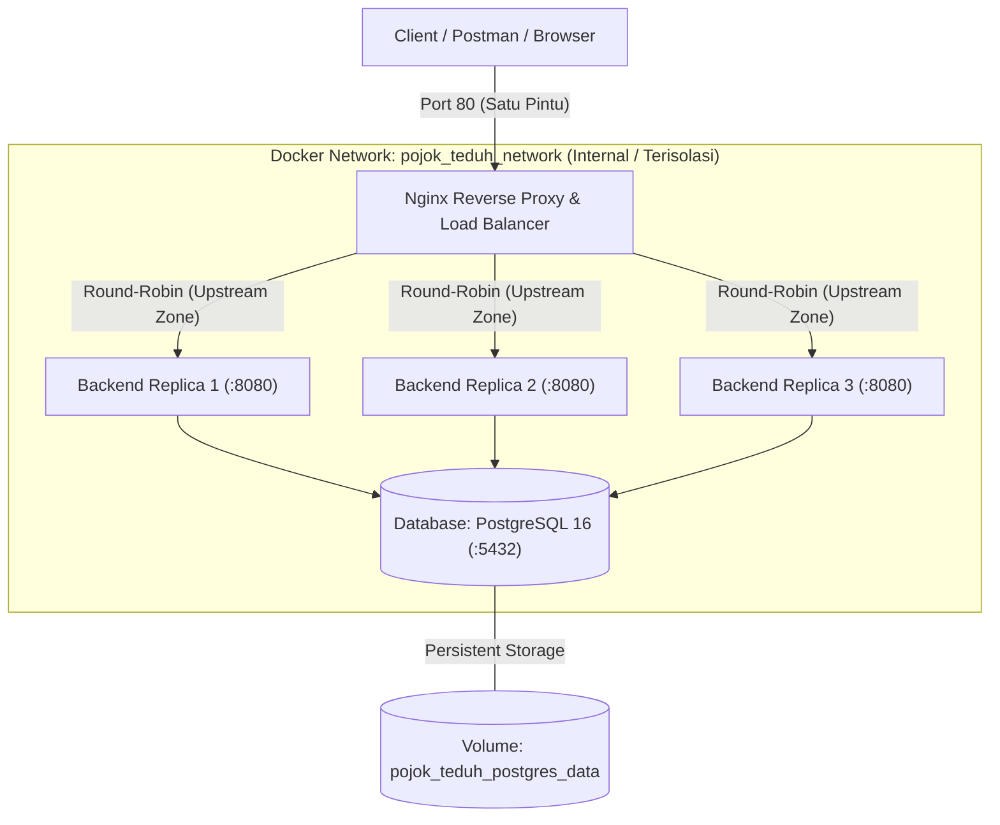

# 🌿 Backend Pojok Teduh - Nginx Reverse Proxy, Load Balancer & Docker Compose

Proyek ini merupakan implementasi Dockerisasi backend RESTful API (Express.js + TypeScript + Drizzle ORM) dan database PostgreSQL dengan penambahan **Nginx sebagai satu-satunya pintu masuk (*Single Entry Point*)**, **Reverse Proxy**, **Load Balancer (3 Replica Backend)**, **Rate Limiter**, **Header Keamanan**, serta kompresi **Gzip**. Seluruh service diorkestrasi menggunakan Docker Compose (`compose.yaml`).

---

## 📋 Daftar Isi
1. [Prasyarat](#-prasyarat)
2. [Arsitektur & Konfigurasi Nginx / Docker](#-arsitektur--konfigurasi-nginx--docker)
3. [Setup Environment](#-setup-environment)
4. [Cara Menjalankan](#-cara-menjalankan)
5. [Bukti Pengujian cURL (Load Balancing, Rate Limit, Gzip, Port Terisolasi)](#-bukti-pengujian-curl)
6. [Jawaban Pertanyaan Evaluasi](#-jawaban-pertanyaan-evaluasi)
7. [Pengujian Endpoint API (Postman)](#-pengujian-endpoint-api-postman)
8. [Langkah Pengujian Persistensi Data (Volume)](#-langkah-pengujian-persistensi-data-volume)
9. [Perintah Docker Berguna Lainnya](#-perintah-docker-berguna-lainnya)
10. [Referensi dan Bantuan AI](#-referensi-dan-bantuan-ai)

---

## ⚙️ Prasyarat

Pastikan perangkat Anda telah terpasang:
- **Docker Desktop** (versi 20.x ke atas / Docker Engine aktif)
- **Docker Compose** (v2 / v5 ke atas)
- **Git**
- **cURL** (atau PowerShell / Postman untuk pengujian API).

---

## 🏗️ Arsitektur & Konfigurasi Nginx / Docker

Proyek ini menerapkan arsitektur satu pintu masuk (*single entry point*) di mana klien publik hanya dapat mengakses port 80 pada Nginx:



### 1. Lima Hal Wajib pada `compose.yaml` dan Konfigurasi Nginx:
1. **Satu Pintu**: Hanya service `nginx` yang mengekspos ports ke host (`80:80`). Service `backend` dan `db` **tidak memiliki `ports`** sama sekali sehingga aman dari akses publik luar.
2. **Reverse Proxy**: Direktif `location /api/` meneruskan permintaan ke upstream backend menggunakan `proxy_pass http://backend_servers/;` lengkap dengan header `proxy_set_header Host $host;` dan `proxy_set_header X-Forwarded-For $proxy_add_x_forwarded_for;`.
3. **Load Balancing**: Backend berjalan dengan **3 replica** (`deploy: replicas: 3`). Blok upstream menggunakan direktif `zone backend_zone 64k;` untuk shared memory antar worker, serta respons menyertakan header pelacak `X-Upstream: $upstream_addr`.
4. **Rate Limit**: Route `/api/` diproteksi menggunakan `limit_req zone=api_limit burst=2 nodelay;` dengan batas `rate=3r/s` dan menolak permintaan berlebih dengan kode status `limit_req_status 429;`.
5. **Header Keamanan & Gzip**: Mengaktifkan proteksi `X-Content-Type-Options: nosniff always;`, `X-Frame-Options: DENY;`, `X-XSS-Protection: 1; mode=block;`, serta `gzip on;` dengan `gzip_proxied any;` dan `gzip_types application/json;`.

---

## 🔐 Setup Environment

1. Salin template konfigurasi `.env.example` menjadi `.env`:
   ```bash
   cp .env.example .env
   ```
   *(Untuk pengguna Windows PowerShell: `Copy-Item .env.example .env`)*

2. Pastikan file `.env` memuat nilai berikut:
   ```env
   PORT=8080
   JWT_SECRET=pojok_teduh_secret_key_2026

   POSTGRES_USER=postgres
   POSTGRES_PASSWORD=postgres123
   POSTGRES_DB=pojok_teduh_db
   DB_PORT=5432

   DATABASE_URL=postgresql://postgres:postgres123@db:5432/pojok_teduh_db?schema=public
   ```

---

## 🚀 Cara Menjalankan

1. **Jalankan Build dan Start Semua Container:**
   ```bash
   docker compose up --build -d
   ```

2. **Periksa Status Container:**
   ```bash
   docker compose ps
   ```
   *Output menunjukkan 5 container berjalan: 1 db, 3 backend replicas, dan 1 nginx (hanya nginx yang memiliki port mapping `80->80`):*
   ```
   NAME                             IMAGE                          STATUS                    PORTS
   pojok_teduh_db                   postgres:16-alpine             Up (healthy)              5432/tcp
   pojok_teduh_nginx                nginx:alpine                   Up                        0.0.0.0:80->80/tcp
   tugas1_belajardocker-backend-1   tugas1_belajardocker-backend   Up                        8080/tcp
   tugas1_belajardocker-backend-2   tugas1_belajardocker-backend   Up                        8080/tcp
   tugas1_belajardocker-backend-3   tugas1_belajardocker-backend   Up                        8080/tcp
   ```

---

## 🧪 Bukti Pengujian cURL

Berikut adalah bukti nyata hasil eksekusi perintah `curl` dari terminal yang membuktikan fitur reverse proxy, load balancing, rate limiting, header keamanan, gzip, dan isolasi port bekerja:

### 1. Bukti Load Balancing (Header `X-Upstream` Berganti Antar 3 Replica)
Perintah curl dieksekusi berulang kali ke endpoint `http://localhost/api/spots/search`. Terlihat jelas nilai header `X-Upstream` berganti secara bergantian (*Round-Robin*) di antara IP ketiga replica backend (`172.18.0.5:8080`, `172.18.0.4:8080`, `172.18.0.3:8080`):

```bash
$ for i in {1..6}; do curl -s -I http://localhost/api/spots/search | grep "X-Upstream"; sleep 0.4; done
```
**Output Terminal:**
```http
X-Upstream: 172.18.0.5:8080
X-Upstream: 172.18.0.4:8080
X-Upstream: 172.18.0.3:8080
X-Upstream: 172.18.0.5:8080
X-Upstream: 172.18.0.4:8080
X-Upstream: 172.18.0.3:8080
```

---

### 2. Bukti Rate Limit (Menolak Permintaan Cepat dengan HTTP 429)
Perintah curl dikirimkan secara beruntun dengan intensitas tinggi tanpa jeda untuk menguji `limit_req`:

```bash
$ for i in {1..7}; do curl -s -o /dev/null -w "%{http_code}\n" http://localhost/api/spots/search; done
```
**Output Terminal:**
```
200
200
200
429
429
429
429
```

Detail output lengkap header saat terkena Rate Limit:
```bash
$ for i in {1..5}; do curl -i -s http://localhost/api/spots/search | head -n 14; done
```
**Output Terminal:**
```http
HTTP/1.1 429 Too Many Requests
Server: nginx/1.31.8
Date: Tue, 10 Nov 2026 07:57:53 GMT
Content-Type: text/html
Content-Length: 169
Connection: keep-alive
X-Content-Type-Options: nosniff
X-Frame-Options: DENY
X-XSS-Protection: 1; mode=block

<html>
<head><title>429 Too Many Requests</title></head>
<body>
<center><h1>429 Too Many Requests</h1></center>
<hr><center>nginx/1.31.8</center>
</body>
</html>
```

---

### 3. Bukti Header Keamanan dan Gzip Kompresi
Perintah curl dengan header `Accept-Encoding: gzip` dikirimkan ke Nginx:

```bash
$ curl -I -H "Accept-Encoding: gzip" http://localhost/api/spots/search
```
**Output Terminal:**
```http
HTTP/1.1 200 OK
Server: nginx/1.31.8
Date: Tue, 10 Nov 2026 07:58:21 GMT
Content-Type: application/json; charset=utf-8
Connection: keep-alive
Vary: Accept-Encoding
X-Powered-By: Express
Access-Control-Allow-Origin: *
ETag: W/"29d1-PrTMQyZnuYGW/vwXw2U5Fv8NEzs"
X-Content-Type-Options: nosniff
X-Frame-Options: DENY
X-XSS-Protection: 1; mode=block
X-Upstream: 172.18.0.5:8080
Content-Encoding: gzip
```
*(Bukti: Header `X-Content-Type-Options: nosniff` dan `Content-Encoding: gzip` aktif pada respons payload JSON).*

---

### 4. Bukti Port Backend Lama (8080) Tidak Bisa Diakses dari Host
Mencoba mengakses port backend lama `8080` langsung dari host machine:

```bash
$ curl -I http://localhost:8080
```
**Output Terminal:**
```
curl: (7) Failed to connect to localhost port 8080: Connection refused
```
*(Bukti: Koneksi ditolak / Connection refused karena port 8080 tidak lagi dipublikasikan ke host).*

---

## 💡 Jawaban Pertanyaan Evaluasi

### (a) Kenapa upstream perlu zone? Apa yang terjadi kalau dihapus?
Direktif `zone` mendefinisikan area memori bersama (*shared memory zone*) yang memungkinkan seluruh worker process Nginx saling berbagi informasi status upstream, konfigurasi server, serta metrik load balancing secara terpusat. Jika direktif `zone` dihapus, setiap worker process Nginx akan mengelola status upstream dan giliran *round-robin* secara terisolasi di memori pribadinya masing-masing. Akibatnya, distribusi beban kerja antar-replica backend menjadi tidak merata dan tidak sinkron karena satu worker tidak mengetahui request yang telah diproses oleh worker lainnya.

### (b) Kenapa limit_req_status diganti ke 429? Apa bedanya dengan bawaan nginx?
Nilai `limit_req_status` diganti ke `429 Too Many Requests` agar mematuhi standar HTTP RFC 6585 yang secara spesifik menandakan bahwa klien telah melampaui batas kecepatan permintaan (*rate limit*). Secara default, bawaan Nginx mengembalikan kode status `503 Service Temporarily Unavailable` ketika request ditolak oleh `limit_req`. Bedanya, status 503 mengesankan adanya kerusakan atau beban berlebih internal pada server, sedangkan status 429 secara tepat mengedukasi klien bahwa penolakan terjadi akibat frekuensi request yang dikirimkan oleh klien itu sendiri.

### (c) Kenapa backend dan database tidak punya ports, dan nginx menjangkau backend lewat apa?
Backend dan database sengaja tidak memiliki `ports` yang dipetakan ke host guna menerapkan arsitektur satu pintu masuk (*single entry point*) dan prinsip keamanan *least privilege*, sehingga service internal tidak dapat ditembus langsung dari jaringan luar. Nginx menjangkau ketiga replica backend melalui jaringan bridge internal Docker (`pojok_teduh_network`) pada port privat 8080. Di dalam jaringan tersebut, DNS internal Docker secara otomatis meresolusi nama service `backend` ke alamat IP masing-masing container replica.

---

## 📮 Pengujian Endpoint API (Postman)

Koleksi Postman siap pakai tersedia pada berkas **`pojok_teduh_postman_collection.json`** di root repositori. Anda cukup mengimpor berkas tersebut ke Postman untuk langsung menguji endpoint melalui Nginx:

### 1. Request: Health Check (Root via Nginx)
- **Method**: `GET`
- **URL**: `http://localhost/api/`
- **Ekspektasi Status**: `200 OK`
- **Respon**:
  ```
  ✅ API Pojok Teduh Berjalan! Silakan akses /api-docs untuk melihat dokumentasi.
  ```

---

### 2. Request: Register User Baru
- **Method**: `POST`
- **URL**: `http://localhost/api/auth/user/register`
- **Headers**: `Content-Type: application/json`
- **Body (raw JSON)**:
  ```json
  {
    "username": "mentee_postman",
    "email": "mentee_postman@example.com",
    "password": "password123"
  }
  ```
- **Ekspektasi Status**: `201 Created`

---

### 3. Request: Login User
- **Method**: `POST`
- **URL**: `http://localhost/api/auth/user/login`
- **Headers**: `Content-Type: application/json`
- **Body (raw JSON)**:
  ```json
  {
    "email": "mentee_postman@example.com",
    "password": "password123"
  }
  ```
- **Ekspektasi Status**: `200 OK` (Kembalian berupa token JWT).

---

### 4. Request: Get All Spots / Search (Load Balanced)
- **Method**: `GET`
- **URL**: `http://localhost/api/spots/search`
- **Ekspektasi Status**: `200 OK` (Periksa tab *Headers* respon untuk melihat `X-Upstream` berganti).

---

### 5. Request: Get Profile (Endpoint Terproteksi)
- **Method**: `GET`
- **URL**: `http://localhost/api/users/profile`
- **Authorization**: `Bearer Token` (Gunakan token dari respons login).
- **Ekspektasi Status**: `200 OK`.

---

## 💾 Langkah Pengujian Persistensi Data (Volume)

Pengujian ini membuktikan bahwa data database tidak hilang saat container dihancurkan dan dibuat ulang karena tersimpan aman pada Docker Named Volume (`pojok_teduh_postgres_data`):

1. **Pastikan Data User Terdaftar**: Jalankan `POST http://localhost/api/auth/user/register` via Postman atau cURL.
2. **Hentikan dan Hapus Container**:
   ```bash
   docker compose down
   ```
   *(⚠️ Jangan gunakan flag `-v` agar volume data tetap utuh).*
3. **Nyalakan Kembali Container**:
   ```bash
   docker compose up -d
   ```
4. **Verifikasi Data Tetap Ada**: Jalankan `POST http://localhost/api/auth/user/login` dengan kredensial yang sama. Respon tetap `200 OK` membuktikan persistensi data berjalan sempurna.

---

## 🛠️ Perintah Docker Berguna Lainnya

| Perintah | Fungsi |
| :--- | :--- |
| `docker compose up --build -d` | Membangun image dan menjalankan seluruh container di background |
| `docker compose ps` | Menampilkan daftar container dan status port |
| `docker compose logs -f nginx` | Melihat log akses dan error Nginx secara realtime |
| `docker compose logs -f backend` | Melihat log replica backend secara realtime |
| `docker compose down` | Menghentikan container tanpa menghapus volume data |
| `docker compose down -v` | Menghentikan container dan menghapus volume (reset data) |

---

## 🤖 Referensi dan Bantuan AI
- **Official Images**: `nginx:alpine`, `node:20-alpine`, `postgres:16-alpine`.
- **Dokumentasi Nginx**: Modul `ngx_http_upstream_module`, `ngx_http_limit_req_module`, `ngx_http_gzip_module`, dan `ngx_http_headers_module`.
- **Bantuan AI**: Menggunakan AI Assistant (Antigravity) dalam perancangan konfigurasi Nginx reverse proxy, load balancer shared memory zone, penataan Docker Compose multi-replica, serta penyusunan bukti uji teknis dan dokumentasi `README.md`.
