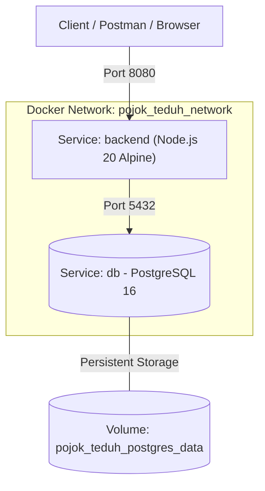

# 🌿 Backend Pojok Teduh - Dockerization & Docker Compose

Singkatnya Projet Pojok Teduh ini berfungsi untuk user bisa mencari tempat yang tenang di tengah hiruk pikuk aktivitas dalam perkotaan,Proyek ini merupakan implementasi Dockerisasi backend RESTful API (Express.js + TypeScript + Drizzle ORM) beserta database PostgreSQL menggunakan **Dockerfile** (multi-stage build) dan **Docker Compose**. Proyek ini dilengkapi dengan volume persistensi data, health check antar-service, serta migrasi database otomatis saat container dijalankan.

---

## 📋 Daftar Isi
1. [Prasyarat](#-prasyarat)
2. [Arsitektur & Konfigurasi Docker](#-arsitektur--konfigurasi-docker)
3. [Setup Environment](#-setup-environment)
4. [Cara Build & Menjalankan Aplikasi](#-cara-build--menjalankan-aplikasi)
5. [Pengujian Endpoint API](#-pengujian-endpoint-api)
6. [Langkah Pengujian Persistensi Data (Volume)](#-langkah-pengujian-persistensi-data-volume)
7. [Perintah Docker Berguna Lainnya](#-perintah-docker-berguna-lainnya)
8. [Referensi dan Bantuan AI](#-referensi-dan-bantuan-ai)

---

## ⚙️ Prasyarat

Pastikan perangkat Anda telah terpasang:
- **Docker Desktop** (versi 20.x ke atas / Docker Engine aktif)
- **Docker Compose** (v2 / v5 ke atas)
- **Git**
- **Postman**, atau web browser untuk pengujian API.

---

## 🏗️ Arsitektur & Konfigurasi Docker

Proyek ini menggunakan arsitektur multi-container dengan 2 service utama:



### 1. `Dockerfile` (Multi-Stage Build)
- **Stage 1 (`builder`)**: Menggunakan image `node:20-alpine`, menginstall dependensi lengkap, dan mengompilasi TypeScript menjadi file JavaScript siap pakai pada direktori `dist/`.
- **Stage 2 (`runner`)**: Menggunakan base image `node:20-alpine` yang ramping, hanya menginstall `dependencies` production (`npm install --omit=dev`), menyalin hasil build `dist/` dan migration files `drizzle/`, sehingga ukuran image akhir sangat ringan dan efisien.

### 2. `docker-compose.yml`
- **`db`**: Menggunakan image `postgres:16-alpine`, port mapping `5432:5432`, volume persistensi `postgres_data`, dan healthcheck `pg_isready`.
- **`backend`**: Dibuat dari `Dockerfile`, mengekspos port `8080:8080`, terhubung ke service `db` dengan `depends_on: { db: { condition: service_healthy } }`.
- **`volumes`**: `postgres_data` (Named Volume) untuk menjamin data database tetap tersimpan meskipun container dimatikan/dibuat ulang.
- **`networks`**: `pojok_teduh_network` (Bridge Network) untuk isolasi dan komunikasi aman antar-container.

---

## 🔐 Setup Environment

1. Duplikat file template konfigurasi `.env.example` menjadi `.env`:
   ```bash
   cp .env.example .env
   ```
   *(Untuk pengguna Windows PowerShell: `Copy-Item .env.example .env`)*

2. Periksa isi file `.env` (nilai default sudah disesuaikan agar langsung siap digunakan dengan Docker Compose):
   ```env
   PORT=8080
   JWT_SECRET=pojok_teduh_secret_key_2026

   POSTGRES_USER=postgres
   POSTGRES_PASSWORD=postgres123
   POSTGRES_DB=pojok_teduh_db
   DB_PORT=5432

   # URL koneksi untuk backend di dalam jaringan Docker Compose (host: db)
   DATABASE_URL=postgresql://postgres:postgres123@db:5432/pojok_teduh_db?schema=public
   ```

---

## 🚀 Cara Build & Menjalankan Aplikasi

1. **Jalankan Build dan Start Seluruh Service:**
   ```bash
   docker compose up --build -d
   ```

2. **Cek Status Container yang Sedang Berjalan:**
   ```bash
   docker compose ps
   ```
   *Pastikan kedua service (`pojok_teduh_db` dan `pojok_teduh_backend`) berstatus `running` / `Up` (healthy).*

3. **Melihat Log Aplikasi:**
   ```bash
   docker compose logs -f backend
   ```
   *Backend akan otomatis menjalankan migrasi skema tabel Drizzle dan menampilkan:*
   ```
   ⏳ Menjalankan migrasi database...
   ✅ Migrasi database berhasil dijalankan!
   🚀 Server BERHASIL JALAN di http://localhost:8080
   ```

---

## 🧪 Pengujian Endpoint API

> 💡 **Pengujian Menggunakan Postman**:  
> Tersedia berkas koleksi siap pakai **`pojok_teduh_postman_collection.json`** di root direktori proyek. Anda cukup melakukan *Import* ke aplikasi Postman untuk langsung menguji seluruh endpoint.

---

### 1. Request: Health Check (Root)
- **Method**: `GET`
- **URL**: `http://localhost:8080/`
- Klik **Send**
- **Ekspektasi Status**: `200 OK`
- **Respon**:
  ```
  ✅ API Pojok Teduh Berjalan! Silakan akses /api-docs untuk melihat dokumentasi.
  ```

---

### 2. Request: Register User Baru
- **Method**: `POST`
- **URL**: `http://localhost:8080/auth/user/register`
- Masuk ke tab **Headers**:
  - `Content-Type`: `application/json`
- Masuk ke tab **Body** $\rightarrow$ pilih **raw** $\rightarrow$ pilih format **JSON**:
  ```json
  {
    "username": "mentee_postman",
    "email": "mentee_postman@example.com",
    "password": "password123"
  }
  ```
- Klik **Send**
- **Ekspektasi Status**: `201 Created`
- **Respon**:
  ```json
  {
    "status": "success",
    "data": {
      "id": 4,
      "username": "mentee_postman",
      "email": "mentee_postman@example.com",
      "role": "USER"
    }
  }
  ```

---

### 3. Request: Login User
- **Method**: `POST`
- **URL**: `http://localhost:8080/auth/user/login`
- Masuk ke tab **Headers**:
  - `Content-Type`: `application/json`
- Masuk ke tab **Body** $\rightarrow$ pilih **raw** $\rightarrow$ pilih format **JSON**:
  ```json
  {
    "email": "mentee_postman@example.com",
    "password": "password123"
  }
  ```
- Klik **Send**
- **Ekspektasi Status**: `200 OK`
- **Respon**:
  ```json
  {
    "status": "success",
    "data": {
      "token": "eyJhbGciOiJIUzI1NiIsInR5cCI6IkpXVCJ9...",
      "user": {
        "id": 4,
        "username": "mentee_postman",
        "email": "mentee_postman@example.com",
        "role": "USER"
      }
    }
  }
  ```
  *(Salin string `token` ini untuk request nomor 5)*

---

### 4. Request: Get All Spots / Search
- **Method**: `GET`
- **URL**: `http://localhost:8080/spots/search`
- Klik **Send**
- **Ekspektasi Status**: `200 OK`

---

### 5. Request: Get Profile (Endpoint Terproteksi JWT Token)
- **Method**: `GET`
- **URL**: `http://localhost:8080/users/profile`
- Masuk ke tab **Authorization**:
  - **Type**: `Bearer Token`
  - **Token**: Tempelkan string token yang didapat dari response Login (Request 3).
- Klik **Send**
- **Ekspektasi Status**: `200 OK`
- **Respon**:
  ```json
  {
    "status": "success",
    "data": {
      "id": 4,
      "email": "mentee_postman@example.com",
      "username": "mentee_postman",
      "role": "USER",
      "photoUrl": null
    }
  }
  ```

---

## 💾 Langkah Pengujian Persistensi Data (Volume)

Pengujian ini membuktikan bahwa data database tidak hilang saat container dihancurkan dan dibuat ulang karena tersimpan aman pada Docker Named Volume (`pojok_teduh_postgres_data`):

### Langkah 1: Pastikan Data User Telah Terdaftar (di Postman)
Gunakan akun yang telah didaftarkan pada pengujian sebelumnya (Request 2: `POST /auth/user/register`):
- **Email**: `mentee_postman@example.com`
- **Password**: `password123`

---

### Langkah 2: Hentikan dan Hapus Container
Di terminal, jalankan perintah berikut untuk menghentikan dan menghapus container yang sedang berjalan:
```bash
docker compose down
```
> ⚠️ **Catatan Penting**: **JANGAN** gunakan flag `-v` agar volume `pojok_teduh_postgres_data` tetap dipertahankan.

---

### Langkah 3: Buat Ulang dan Nyalakan Container Baru
Nyalakan kembali seluruh service dari container baru:
```bash
docker compose up -d
```
Verifikasi bahwa container baru sudah berjalan dan berstatus sehat (*healthy*):
```bash
docker compose ps
```

---

### Langkah 4: Verifikasi Data Tetap Ada (Login Ulang di Postman)
Kembali ke Postman, buka **Request 3: Login User** (`POST http://localhost:8080/auth/user/login`):
- **Body (JSON)**:
  ```json
  {
    "email": "mentee_postman@example.com",
    "password": "password123"
  }
  ```
- Klik tombol **Send**.

**Hasil yang Diharapkan**:
- Status respon tetap **`200 OK`**.
- Respon mengembalikan token JWT yang valid dan data user `mentee_postman`.
- **Kesimpulan**: Data user tidak hilang dan berhasil dimuat kembali dari volume Docker meskipun container sebelumnya telah dihapus dan dibuat ulang.

---

## 🛠️ Perintah Docker Berguna Lainnya

| Perintah | Fungsi |
| :--- | :--- |
| `docker compose up --build -d` | Membangun image dan menjalankan container di background |
| `docker compose ps` | Menampilkan status dan healthcheck container yang sedang berjalan |
| `docker compose logs -f` | Menampilkan log real-time dari semua container |
| `docker compose down` | Menghentikan dan menghapus container (volume data tetap aman) |
| `docker compose down -v` | Menghentikan container dan menghapus seluruh volume (reset data) |
| `docker compose restart backend` | Merestart service backend saja |

---

## 🤖 Referensi dan Bantuan AI
- **Framework & Libraries**: Express.js, TypeScript, Drizzle ORM, PostgreSQL Driver (`pg`), Swagger UI Express, Bcryptjs, JSONWebToken.
- **Docker Images**: `node:20-alpine` (official Node.js Docker Hub), `postgres:16-alpine` (official PostgreSQL Docker Hub).
- **Bantuan AI**: Menggunakan AI Assistant (Antigravity) dalam penyusunan multi-stage `Dockerfile`, konfigurasi `docker-compose.yml`, pembuatan skrip migrasi database otomatis, dan standarisasi dokumentasi `README.md`.
